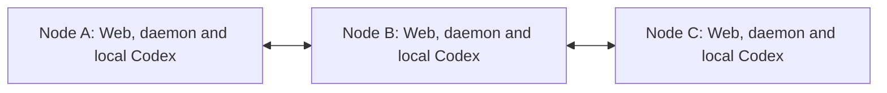
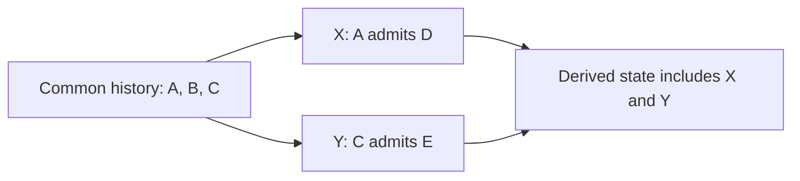
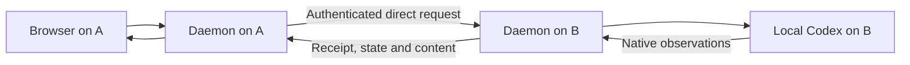

# Decentralized Network design

Status: design only. The product behavior and membership rules below are agreed: compatible changes merge automatically, incompatible valid histories remain separate branches, and returning nodes verify missing history before regaining Network access. The details listed under [Open protocol decisions](#open-protocol-decisions) remain prerequisites for implementation. Network functionality remains unimplemented in the [current product scope](mvp.md). This design assigns no release target and introduces no executable commands or HTTP endpoints.

A Network connects Dewbow instances belonging to one person across a LAN or an existing VPN. Its members are peers. Any member can admit another device, provide an operator interface, or remove any member, including itself and the original creator. Execution and conversation data remain owned by the machine on which they originate.

## Scope and terms

The first scope is one person managing their own machines over an already reachable network. A node participates in at most one Network and one selected branch at a time, or in none. Retaining evidence about another branch does not make the node an active participant in it. Dewbow does not provision a VPN, assign network addresses, perform NAT traversal, or require a public relay. Team accounts, human roles and external agent access are outside this design.

| Term | Meaning |
| --- | --- |
| Network | A group identified by a shared network identity and verifiable membership relationships |
| Node | A Dewbow daemon instance with its own host identity, selected state directory and local Codex integration |
| Membership | A node's admission to a particular Network, distinct from its current reachability |
| Membership generation | One specific admission of a node; a later admission has a new identity |
| Change | An immutable, signed member-management operation with its causal context |
| Accepted history | The causally complete set of changes a node has adopted |
| Branch | An accepted history and its continuations that exclude an incompatible alternative |
| Entry node | The node whose local Web or CLI the operator is currently using |
| Execution node | The node selected to handle an operation and, when applicable, execute it through its local Codex runtime |
| Membership synchronization | Exchange of membership and authorization changes between peers |

Node identity refers to a Dewbow instance, rather than a physical machine name or IP address. Joining or leaving a Network preserves the existing host identity and native conversation associations. A later admission must be distinguishable from a membership that has already been removed.

## Nodes have equal authority

There is no fixed coordinator, enrollment server, mandatory router, or privileged creator. Creating a Network establishes its initial identity and first member; it does not grant that node permanent control over other members. Verification of an admitted peer must not require contacting the creator or its inviter on every connection.

Membership changes are not ordered by an elected leader or a majority vote. Each node adopts compatible changes and explicitly selects among incompatible alternatives under the rules below.

Every valid member provides the same Network capabilities to its locally authenticated operator: invite a device, use other members through the operator interface, and remove any current member. These actions are explicit operator operations. They are not native Codex callbacks or autonomous agent permissions.

The diagram permits A and C to have no direct connection. Signed membership changes can travel from A through B to C, with C independently verifying the original records. Forwarding does not grant B authority to rewrite them or become a fixed router. B's disappearance or exclusion can break the only available propagation path; eventual delivery requires a surviving path.

Membership propagation does not provide execution-request forwarding. A node can learn a peer's address from another member and connect directly when needed. If the selected execution target cannot be reached directly, the entry node reports that limitation; execution through an intermediary is outside the first scope.

If A creates a Network and B and C join, B and C can continue operating when A is offline. B or C can also admit another node while A remains offline. No election of a replacement center is necessary.

## Creating and joining a Network

### Creation

The operator creates a Network on any node that is not currently participating in one, chooses a display name and an interface/address reachable by the intended peers. A signed genesis record establishes the common origin, protocol interpretation and first membership. Its identity is independent of a particular IP address. Separate genesis records identify separate Networks and do not merge automatically.

Creation does not change existing host or native session identities, connect an existing native conversation, or start a model turn. The creator has the same authority and removal rules as every subsequently admitted member.

### Admission through any member

1. The operator requests a single-use invitation from any valid member. Its default lifetime is 10 minutes.
2. The invitation is one transferable string containing the Network origin, the issuer's branch context, connection and identity-verification information, and a one-use admission credential. It is transferred through a trusted channel.
3. The joining node verifies the intended Network and inviting peer, establishes its own device identity proof, and submits a join attempt.
4. The operator confirms the joining device on the inviting node. Confirmation is local to that node; neither the creator nor another designated machine has to participate.
5. The inviting node records the admission and consumes the invitation before reporting local success. The joining node retains its membership and the information needed to contact and authenticate other peers. Success means acceptance in this history, without promising that an undiscovered incompatible history cannot exist.
6. Membership synchronization distributes the verifiable admission. Other members validate it and can communicate directly with the new member without using its inviter as a router.

An invitation is redeemed with its issuer for single-use accounting. That issuer is only the entry point for this invitation. If it is unavailable or its membership has been removed in the selected history, another valid member must issue a new invitation. No unique node issues all invitations for the Network. A compatible continuation still requires revalidation of the issuer and invitation; an incompatible branch cannot silently reuse the invitation. Expiry blocks a new redemption, not retrieval of a previously recorded result for an identical join attempt.

Join retries retain the same attempt identity and device identity material. Losing the confirmation response must not create duplicate memberships, consume a second invitation, or silently replace a retained device identity. A retry can recover the recorded result of the original attempt.

Invitation secrets and device private keys are private local material. Invitation issuance and expiry are managed by the issuer; the successful admission and required verification evidence enter shared history. Membership synchronization carries verification information, not private keys, invitation secrets, native credentials, or browser/control credentials. Exact encodings, time validation and key handling belong to the protocol specification.

## Removing any member or leaving locally

The operator on any valid member can remove any member of the current Network. The target can be another node, the local node, or the original creator. The target need not approve the operation or be online. Local self-exit and removal of another node use the same membership-removal semantics.

| Action from node A | Required result |
| --- | --- |
| Remove B | Record removal of B's current membership, reject B locally, and propagate the removal to other members |
| Leave as A | Record A's own departure, stop A's participation and Network authority, and distribute the departure when possible |
| Remove an offline B | Apply the removal without waiting for B; peers enforce it after validation and adoption under the branch rules |
| Remove the creator | Apply the same rule as for any other member; other members retain their Network capabilities |
| Join again after removal | Require a new invitation and confirmation for a new membership; reconnecting with old credentials cannot restore the removed membership |

The initiating node authenticates the local operator, persists a verifiable removal record, and applies it locally before reporting local success. A peer that validates and adopts that removal rejects future requests under the removed membership and closes connections and subscriptions authorized by it. A valid removal conflicting with already accepted history is handled as a branch, rather than silently replacing that history. Acknowledgement from the removed node is not a prerequisite for enforcing its exclusion in the adopted branch.

Removal concerns Network access. It does not remotely erase a device's files or private state, stop its daemon, clear Codex credentials, delete conversations or request receipts, or interrupt work already admitted on that device. The device remains usable locally. For example, after removing B, tasks already running on B continue and can be managed through B's local interface.

Removal records are retained so that delayed synchronization, old invitations or an old device snapshot cannot silently reactivate a removed membership in a history that excludes it. Repeating the same removal has no additional effect. Admission and removal need identities independent of display names and addresses. Removing B's membership B1 never removes a later, explicitly admitted B2. A removal does not cascade to admissions already established in its causal past; a concurrent admission by the removed issuer follows the conflict rules below.

### Offline exit and propagation

A node leaving itself first retains its departure record and an intent scoped to its old membership generation, hands the record to reachable members when possible, and stops normal participation immediately. If completely disconnected, local exit still takes effect. When connectivity returns, it automatically retries delivery through a restricted departure channel; that channel grants no session access, execution, invitations or removal of another member.

If the original departure has compatible context, recipients incorporate it normally. If its enclosing history conflicts with a recipient's branch, that branch must not be merged merely to deliver the departure. The departed node may verify the recipient's necessary context and sign a new statement withdrawing only its own old membership in that context, without adopting the recipient's branch or restoring ordinary authority. Original signed records are never rewritten. An already absent old membership is acknowledged idempotently; a later membership generation is unaffected. The exact proof exchange and signing restrictions remain protocol work.

Peers that have not received a removal may temporarily retain the old membership view. An isolated node cannot enforce information it has not received. The interface distinguishes local application from dissemination to other known peers, for example, "Removed locally; some peers have not acknowledged the update." It must not claim immediate Network-wide exclusion or a complete global membership count during a partition.

Nodes with the same complete, compatible accepted change set derive the same membership state. Incompatible histories may remain separate after connectivity returns. A node in another branch cannot be compelled to select a removal merely by receiving it.

## Membership synchronization

Membership synchronization lets each node independently answer which devices belong to the Network and which membership credentials it currently accepts. Nodes exchange the minimum identity and authorization information needed to validate admissions and removals, locate peers, and detect missing changes.

Synchronization must tolerate duplicate, delayed and reordered updates and interrupted connections. It exchanges records and causal evidence, not an authoritative remote snapshot. Each recipient verifies changes before adopting them. Replaying an older view must not overwrite accepted removals. A change from an unrelated Network or an unauthenticated source cannot grant authority.

### History and validation

History is a DAG rooted at genesis. Each immutable change identifies the origin, its causal predecessors, author and membership generation, operation identity and contents, and signature. A display sequence or height is not a unique identity or evidence of global order. Two different changes can have the same height. Causality comes from authenticated predecessor relationships, not wall-clock timestamps.

A node validates signatures and authorization against the complete history referenced by a change. Concurrent changes are those for which neither is a causal predecessor of the other. The normal operation set is admission, removal and self-departure. New operation types require explicit validation and compatibility rules before support.

| Received evidence | Required handling |
| --- | --- |
| Identical change received again | Deduplicate without creating a new change |
| Invalid signature, malformed record or unauthorized operation in its own complete causal context | Reject; invalid input cannot force a fork or local exit |
| Missing predecessors or authorization evidence | Keep pending and fetch evidence; grant no authority and infer no conflict |
| Valid changes with compatible complete contexts | Merge according to the rules below |
| Histories individually valid but incompatible together | Retain branch evidence; do not merge automatically |

An ordinary management operation signed on top of a history that already removes its author's authority is unauthorized. An operation based on an older history that lacks a concurrent removal may instead be valid in an alternative branch. These cases must not be conflated; the narrow self-departure exception is specified below.

### Automatic merge rules

Automatic merging is limited to operations whose effects and authorization remain compatible in every ordering allowed by causality. The complete union must preserve membership uniqueness, invitation single use and all authorization dependencies. A signed self-departure is a narrow exception: proof of ownership can withdraw only that old membership, even when another change already withdraws it; it grants no management authority.

| Concurrent operations | Outcome | Required condition |
| --- | --- | --- |
| A admits D; C admits E | Automatic merge | Distinct devices, admissions and invitations; neither authorization dependency is affected |
| A removes B1; C removes B1 | Automatic merge | Same targeted generation; neither author loses authority through the other operation |
| A removes B1; E removes D1 | Automatic merge | Each author's authority and dependencies remain valid under the other operation |
| B leaves B1; A removes B1 | Automatic merge | Both withdraw only B1; the self-departure exception applies |
| B leaves; A admits D | Automatic merge | D's admission has no affected dependency on B |
| A removes B1; B admits D | Fork | The concurrent removal affects the admitting authority |
| A removes B1; B removes A1 | Fork | Each removal affects the other's authority |
| A removes B1; B removes C1 | Fork | Different targets do not preserve B's authority |
| B leaves; B concurrently admits or removes another member | Fork | The other operation depends on B's ordinary authority |
| Different admissions of the same device | Fork | Identical join retries must have been deduplicated; distinct memberships cannot silently collapse |
| Different join attempts consume the same invitation in separately valid histories | Fork | A normal issuer must reject the second redemption before signing; competing signed histories cannot combine into two uses |

The table applies only to individually valid concurrent operations. A later admission of B2 after removal of B1 is not a restoration of B1; a delayed removal of B1 cannot affect B2. An admission that is already a predecessor of its inviter's removal remains established. The selected branch treats unredeemed invitations from a removed issuer as unusable.

Check complete causal closures, not just pairs of tips or connected groups of pairwise-compatible events. If D's admission conflicts with a removal of its inviter, D's later operations cannot be detached from that admission to bypass the conflict. Conversely, an unrelated change may be present in both alternative branches without making those branches mutually compatible.

Merging derives state from the union of compatible accepted changes. It does not rewrite an original signature or create competing author-signed merge decisions. The same complete accepted operation set and protocol interpretation must yield the same state and state commitment, regardless of delivery order or how many nodes computed it. A deterministic display order cannot make an authorization conflict compatible. Concrete commitments and a formal closure algorithm remain prerequisites for implementation.

### Fork selection and access

A fork exists when individually valid histories cannot coexist under the compatibility rules. There is no automatic winner based on length, height, timestamp, arrival order or member count. A node preserves already accepted history when it discovers an incompatible alternative. If it has not selected either alternative, including when both extend its current history with compatible shared changes, the operator chooses explicitly. Compatible updates are accepted by default; explicitly rejecting a valid compatible continuation stops local participation instead of silently creating an active old-version Network.

Learning an alternative is different from selecting it. A node may retain conflict evidence while participating in only one branch. Membership lists in two candidate histories can both include a device, but that does not authorize it to operate in both. Switching to an incompatible branch is an explicit exit and fresh-admission workflow, never an automatic history replacement or resurrection of an old membership. Branches do not merge automatically after a genuine conflict.

Before new remote business operations, peers reconcile their adopted membership context. A compatible difference is synchronized and revalidated; a known incompatible branch is denied business access. Shared genesis, a shared event, an old credential or equal display names alone does not establish current authorization. Minimal evidence or departure exchange does not grant conversation access. State selection and request admission must be coordinated so a concurrent local removal cannot bypass this check.

Convergence applies to the same compatible accepted event set within the same selected branch. A currently compatible merge is not proof that an undiscovered conflict cannot arrive later. With incomplete knowledge, initial adoption can precede discovery of an alternative; its later discovery reports a fork without automatic rollback. Branch selection can therefore differ between nodes even though compatible merge results must be independent of receipt order.

### Returning offline nodes

A returning node first exchanges history summaries over a restricted verification path, fetches missing predecessors and checks its membership and branch before normal remote access resumes. An unauthorized peer receives only evidence needed for the permitted verification or departure purpose, not unrestricted metadata, session content or execution access. There is no requirement to contact the creator or gather votes from every member.

| Returning node state | Required behavior |
| --- | --- |
| No local changes; a complete compatible continuation is available | Verify and adopt it under the default acceptance rule |
| Local changes and remote changes are compatible | Merge the complete sets without losing either side's operations |
| Already accepted local history conflicts with a remote history | Keep the selected branch, report the fork and require explicit action to switch |
| Multiple incompatible continuations are known and none is selected | Pause cross-node business until the operator chooses |
| History or proofs are incomplete | Remain pending; do not infer failure, compatibility or global uniqueness |
| The adopted history removes the returning membership | Disable Network authority; preserve local operation and native work |
| The node has already left locally | Retry only the restricted departure workflow; never restore ordinary membership |

One reachable peer's history is not evidence that no other branch exists. Retry discovery through available paths without claiming a complete global view. Applying a removal before another peer receives it remains a local fact; the interface shows known adoption and propagation status rather than a Network-wide completion claim.

Reachability is observed separately. A can report that it cannot reach C without claiming that C is unreachable from B or no longer a member. Timeouts, process restarts and VPN interruptions do not themselves remove membership. Live reachability observations are runtime display state.

Membership synchronization does not replicate conversation messages, native tool items, command output, diffs, working files, native credentials or completed native turn history. Session inventory and content are requested from their owning node when needed. They are not added to a shared membership log or durable cache.

## Worked membership scenarios

These examples define required outcomes for the future protocol, not results from an implementation.

| Scenario | Changes and history | Required result |
| --- | --- | --- |
| Independent admissions with an offline peer | Start with A, B, C; B is offline. A admits D while C independently admits E | Merge both admissions into A, B, C, D, E. B later verifies and derives the same state regardless of delivery order |
| Independent removals | Start with A, B, C, D, E. A removes B1 while E removes D1 | Merge into A, C, E because the authors' authority remains valid |
| Removal races admission | Start with A, B, C. A removes B1 while B admits D without knowing the removal | Retain an A, C branch and an A, B, C, D branch. C chooses if it has not selected either. Local admission success is not global finality |
| Admission precedes removal causally | B admits D; A adopts that admission and then removes B | D remains a member. Display timestamps or real-time order without the authenticated dependency are insufficient to establish this case |
| A shared compatible change accompanies a conflict | X is A removing B; Y is B admitting D; Z is C admitting E | X and Y conflict. Candidate histories can contain X plus Z or Y plus Z; Z cannot bridge the conflicting histories |
| Mutual removal | A removes B1 while B removes A1, with C also present | One branch retains A and C; the other B and C. Neither a global winner nor a combined removal of both is inferred; C participates in one selected branch |
| Offline self-departure | C leaves while disconnected, as A independently admits D | C stops immediately. Its later departure delivery merges with the independent admission, yielding A, B, D |
| Removal discovered on return | C has no conflicting local changes and returns to a compatible continuation removing C1 | C adopts the verified history and disables Network authority without deleting local work |
| Explicit readmission and stale evidence | B1 was removed, B2 is later admitted, and an offline peer forwards an old removal of B1 | Keep B2. The old membership cannot regain authority or remove the new one |
| Last valid member leaves | No valid member remains in a selected branch | Stop participation. Old invitations cannot recreate authority; normal setup requires a new genesis. State-loss recovery is separate protocol work |

## Operator entry points

Every member can serve as an entry node. The operator opens that node's local Web, authenticates locally, selects the current Network and chooses a target node and conversation. Using A's Web makes A an entry point for that interaction, without giving it a special Network role. Using C's Web to operate B follows the same rules.

The browser communicates with its local daemon. The daemon communicates with the selected peer using Network authentication. Browser cookies and the private CLI control credential stay local; joining a Network does not distribute them. Peer requests carry operator authority only after the entry node has authenticated the operator and the execution node has independently validated the peer and requested operation.

Discovery, history reads and membership synchronization do not adopt or resume native conversations. Continuing an existing native conversation still requires explicit connection, and a native writer conflict remains a conflict.

## Request execution and recovery

When the operator uses A's Web to send a message to a conversation on B, the request takes this path:

A authenticates the operator and selects the destination. B validates the Network, adopted branch context, the caller's membership and the operation, then applies its local execution rules. A target includes the Network origin, branch context, host and session identities; a session ID alone must not choose a machine implicitly. Working directories and native configuration are resolved on B.

B owns the authoritative delivery receipt, managed binding, native turn association and recovery decision. It records the request before calling its local Codex runtime. Multiple entry nodes operating the same conversation must share B's existing admission and serialization rules, including at most one active or unresolved turn. Network access does not weaken B's sandbox, approval policy or callback checks.

Delivery and execution completion remain distinct. If A loses the response, the result is uncertain rather than successful or definitely unexecuted. Recovery queries B's original receipt. Within B's supported retry window, an identical retry retains the original request ID, input and destination and must not start a second native action or be redirected to a different machine. Changed input conflicts while the receipt is retained. The current local [receipt retention policy](storage.md) guarantees at least 24 hours and protects uncertain delivery beyond that window; reusing an ID after cleanup may execute new work. Peer clients must respect the target's guarantee rather than assume indefinite retries. The peer request namespace and routing associations must be specified compatibly with existing retained receipts before implementation.

Membership merges, forks and branch switches do not roll back native execution, replay a request or authorize resubmission as fresh work. Reconciliation still requires current authorization to query B. If branch separation or removal blocks it, delivery remains uncertain; it is never inferred to have failed. Branch context cannot create a new deduplication namespace that silently bypasses a retained original receipt.

Disconnecting a browser or entry node does not stop work already admitted by B. The remaining authorized nodes can subsequently query B. Once B applies a caller's removal, it rejects further requests and subscriptions from that membership; this does not automatically cancel previously admitted work.

Question and approval callbacks remain owned by B's native runtime. Network reconnect within the same runtime does not by itself invalidate a pending callback, but responses still require a currently authorized caller and the exact interaction identity. Restarting that runtime invalidates its old callbacks. Responses are not replayed automatically.

History, output, diffs and live updates originate from B's native Codex state or bounded runtime buffers. A may relay them to its viewer transiently. Subscription identities and cursors must distinguish B's runtime instance from A's and preserve the existing native-history semantics. Neither node creates a second durable conversation archive as part of networking.

## Ownership and compatibility

Each node retains its own selected state directory and one live management database. Network metadata is limited to identity and trust relationships, admissions, invitations, signed membership history and removal evidence, accepted branch associations, and minimum routing and recovery associations. Retain the complete adopted membership history from genesis; bounded alternative-branch evidence and any future compaction need explicit retention rules. This is management history only. Private keys remain protected local material. Native conversations and credentials remain in the selected Codex home, and working files remain in their work directories.

Persisting Network metadata extends the current management-record allowlist and therefore needs an explicit storage-policy and compatibility review during implementation. The current schema and configuration readers reject unknown formats and records. This design does not add records to schema 1, change version markers, reset existing state, or create another live database.

An implementation must define ordered migrations and configuration evolution for supported released formats, following [management storage and compatibility](storage.md). It must preserve host/session identities, frozen configuration, fingerprints and receipts required by the retention policy, and uncertain recovery associations, with recoverable backups and interruption handling. Key and membership recovery must not restore revoked authority silently. Restoring an older private snapshot is not proof of current membership or the absence of later branches.

The existing [Web API](interfaces.md) and [OpenAPI contract](openapi.yaml) continue to describe implemented local behavior. Future Network operations and peer contracts need their own input validation, authority, versioning and recovery definitions, with coordinated updates to those documents when implemented. Network design does not expose the private CLI control operations to peers.

Ownership remains within the existing project boundaries: CLI workflows in apps/cli, peer management and routing in apps/daemon, operator views in apps/web, shared contracts in packages/protocol, native Codex integration in packages/sdk, and controlled presentation in packages/ui. No separate central application is introduced.

## Security boundary

Signatures and authenticated causal references protect the integrity of obtained history. Normal synchronization must not roll back adopted removals or admit ordinary traffic from an incompatible branch. Invalid traffic, missing data and repeated messages cannot force a valid branch change. These are design requirements, not a claim of a proven or implemented Byzantine consensus protocol.

A stolen device can retain its old key and state, sign alternative history, withhold records or mislead an isolated peer that has not learned other history. The protocol does not automatically identify which branch represents the human owner, guarantee universal revocation, or prove that all changes have been discovered. Selecting a branch and rejecting its excluded identities cannot erase other branches or previously obtained data. Stronger owner-authentication or recovery guarantees remain open; an independently held management credential has not been selected as a requirement.

## Open protocol decisions

The following details remain open without changing the agreed decentralized behavior:

- Exact signed encodings, canonical hashing, causal frontiers, accepted-set commitments and stable branch references. Formalize whole-history compatibility and authorization closure, including more than two concurrent changes and replay-safe join accounting, before implementing the agreed outcomes.
- Trust bootstrap, device proofs, encrypted transport, key handling, identity recovery and stronger protection against stolen-node history fabrication. Ordinary key rotation has no automatic merge rule yet and must not be introduced implicitly.
- Peer discovery, address updates, bounded proof forwarding, history exchange, quotas and safe retention or compaction of alternative-branch evidence and membership proofs.
- The restricted self-departure exchange, verification of another branch's context, signing restrictions after exit and recovery after all useful state has been lost.
- Concrete CLI and HTTP operations, peer envelopes and version negotiation, retry namespaces and receipt associations across compatible updates and explicit branch changes, within the target's retention guarantee.
- The preserving storage/configuration migrations and upgrade fixtures needed for the extended management allowlist.

No fixed ports, heartbeat periods, wire schemas, cryptographic libraries or release versions are selected by this document. The 10-minute default invitation lifetime, single active Network, compatibility outcomes and return behavior above are decided product rules rather than open defaults.

## Acceptance requirements for a future implementation

These are required scenarios, not claims of completed validation:

1. A creates a Network; B and C join. A goes offline. B and C continue operating and B admits D without A.
2. A node admitted through B can authenticate and operate with C after B goes offline, using retained verifiable membership information.
3. The operator uses A's local Web to operate B, then C's local Web to operate B. Both paths enforce B's local policy and conversation serialization.
4. From any valid member, remove any other member, including the creator or an offline device, without waiting for the target's consent.
5. A leaves itself while peers are reachable, and again in a disconnected scenario. Local participation stops immediately; retained departure information can propagate later without restoring authority.
6. Compatible complete histories converge after a partition without an authority node. Incompatible histories remain explicit branches; old snapshots, longer branches and stale credentials cannot automatically roll back a selected removal. Explicit readmission creates a distinguishable new membership.
7. Repeated and interrupted joins/removals are idempotent. Invalid changes are rejected, incomplete evidence remains pending, and neither can trigger a fork. Distinct valid conflicts follow the compatibility table.
8. Losing a send response leaves delivery uncertain. Within the target's supported retry window, retrying against the same target, including after restart, preserves the original receipt and does not duplicate execution. Uncertain delivery remains protected beyond that window; settled receipts follow the target's retention policy. A branch change never silently starts another execution.
9. Disconnecting or removing an entry node leaves admitted target work intact. Local conversations, files, credentials and retained receipts survive Network removal.
10. Membership synchronization contains no conversation archive. Native content reads remain read-only, bounded live data remains volatile, and runtime restart invalidates old approval/question callbacks.
11. Upgrade and recovery fixtures preserve existing management state and the Network trust/removal boundary across the supported formats defined for implementation.
12. Every worked membership scenario above produces its stated result. Compatible results are invariant under reordering, duplication, interrupted exchange and computation by different nodes, including groups of more than two changes.
13. A shared compatible event can appear in each candidate branch without joining incompatible histories. A dependent admission or operation cannot be detached from conflicting authorization history.
14. Returning nodes distinguish compatible catch-up, local compatible changes, existing branch conflicts, unselected alternatives, incomplete evidence, adopted exclusion and prior self-exit before remote access resumes.
15. An exited node automatically delivers its own old-generation withdrawal across compatible or incompatible contexts through the restricted channel without regaining ordinary authority, changing original signatures or affecting a later admission.
16. Invitations use the complete transferable string, 10-minute default lifetime, issuer-side confirmation and idempotent recorded-result recovery. Single-use checks reject ordinary double redemption, and separately valid double-use histories cannot automatically merge.
17. A node has at most one active Network branch. Removal of the creator, last-member exit, non-fully-connected topology, delayed malicious alternatives and branch selection never imply a global owner decision or a completed all-peer revocation.
