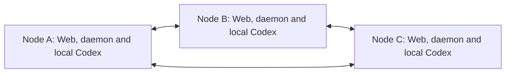
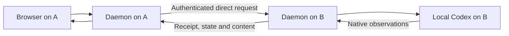

# Decentralized Network design

Status: design only. The product rules below are agreed; the protocol details listed under [Open protocol decisions](#open-protocol-decisions) still need to be specified. Network functionality remains unimplemented in the [current product scope](mvp.md). This design assigns no release target and introduces no executable commands or HTTP endpoints.

A Network connects Dewbow instances belonging to one person across a LAN or an existing VPN. Its members are peers. Any member can admit another device, provide an operator interface, or remove any member, including itself and the original creator. Execution and conversation data remain owned by the machine on which they originate.

## Scope and terms

The first scope is one person managing their own machines over an already reachable network. Dewbow does not provision a VPN, assign network addresses, perform NAT traversal, or require a public relay. Team accounts, human roles and external agent access are outside this design.

| Term | Meaning |
| --- | --- |
| Network | A group identified by a shared network identity and verifiable membership relationships |
| Node | A Dewbow daemon instance with its own host identity, selected state directory and local Codex integration |
| Membership | A node's admission to a particular Network, distinct from its current reachability |
| Entry node | The node whose local Web or CLI the operator is currently using |
| Execution node | The node selected to handle an operation and, when applicable, execute it through its local Codex runtime |
| Membership synchronization | Exchange of membership and authorization changes between peers |

Node identity refers to a Dewbow instance, rather than a physical machine name or IP address. Joining or leaving a Network preserves the existing host identity and native conversation associations. A later admission must be distinguishable from a membership that has already been removed.

## Nodes have equal authority

There is no fixed coordinator, enrollment server, mandatory router, or privileged creator. Creating a Network establishes its initial identity and first member; it does not grant that node permanent control over other members. Verification of an admitted peer must not require contacting the creator or its inviter on every connection.

Every valid member provides the same Network capabilities to its locally authenticated operator: invite a device, use other members through the operator interface, and remove any current member. These actions are explicit operator operations. They are not native Codex callbacks or autonomous agent permissions.

The links show direct peer communication. They do not require every pair to maintain a permanent connection. A node can learn about peers from another member and then connect directly when needed. If the selected target cannot be reached directly, the entry node reports that limitation; the first scope does not depend on an intermediary for request forwarding.

If A creates a Network and B and C join, B and C can continue operating when A is offline. B or C can also admit another node while A remains offline. No election of a replacement center is necessary.

## Creating and joining a Network

### Creation

The operator creates a Network on any node, chooses a display name and an interface/address reachable by the intended peers. The node establishes the Network identity, its own verifiable membership and the local peer connection configuration. Network identity is independent of a particular IP address.

Creation does not change existing host or native session identities, connect an existing native conversation, or start a model turn. The creator has the same authority and removal rules as every subsequently admitted member.

### Admission through any member

1. The operator requests a short-lived, single-use invitation from any valid member.
2. The invitation supplies the Network identity, the inviting peer's connection and identity-verification information, and a one-use admission credential. It is transferred through a trusted channel.
3. The joining node verifies the intended Network and inviting peer, establishes its own device identity proof, and submits a join attempt.
4. The operator confirms the joining device on the inviting node. Confirmation is local to that node; neither the creator nor another designated machine has to participate.
5. The inviting node records the admission and consumes the invitation before reporting success. The joining node retains its membership and the information needed to contact and authenticate other peers.
6. Membership synchronization distributes the verifiable admission. Other members validate it and can communicate directly with the new member without using its inviter as a router.

An invitation can be bound to its issuer for redemption and single-use accounting. That issuer is only the entry point for this invitation. If it is unavailable, another valid member can issue a new invitation. No unique node issues all invitations for the Network.

Join retries retain the same attempt identity and device identity material. Losing the confirmation response must not create duplicate memberships, consume a second invitation, or silently replace a retained device identity. A retry can recover the recorded result of the original attempt.

Invitation secrets and device private keys are private local material. Membership synchronization carries verification information, not private keys, native credentials, or browser/control credentials. Exact invitation lifetimes, proof formats and key handling belong to the protocol specification.

## Removing any member or leaving locally

The operator on any valid member can remove any member of the current Network. The target can be another node, the local node, or the original creator. The target need not approve the operation or be online. Local self-exit and removal of another node use the same membership-removal semantics.

| Action from node A | Required result |
| --- | --- |
| Remove B | Record removal of B's current membership, reject B locally, and propagate the removal to other members |
| Leave as A | Record A's own departure, stop A's participation and Network authority, and distribute the departure when possible |
| Remove an offline B | Apply the removal without waiting for B; peers enforce it as they receive and validate the record |
| Remove the creator | Apply the same rule as for any other member; other members retain their Network capabilities |
| Join again after removal | Require a new invitation and confirmation for a new membership; reconnecting with old credentials cannot restore the removed membership |

The initiating node authenticates the local operator, persists a verifiable removal record, and applies it locally before reporting local success. Every peer that receives and validates the removal persists it, rejects future requests under the removed membership, and closes connections and subscriptions authorized by that membership. Acknowledgement from the removed node is not a prerequisite for enforcing its exclusion.

Removal concerns Network access. It does not remotely erase a device's files or private state, stop its daemon, clear Codex credentials, delete conversations or request receipts, or interrupt work already admitted on that device. The device remains usable locally. For example, after removing B, tasks already running on B continue and can be managed through B's local interface.

Removal records are retained so that delayed synchronization, old invitations or an old device snapshot cannot silently reactivate a removed membership. Repeating the same removal has no additional effect. Admission and removal need identities independent of display names and addresses, so an explicit new admission can be distinguished from replay of an old one. Removal targets the selected membership; it is not an instruction to remove every other device previously invited by that node.

### Offline exit and propagation

A node leaving itself first retains its departure record and, when possible, hands it to reachable members before closing its normal peer connections. If it is completely disconnected, local exit still takes effect immediately. It retains the minimum departure information needed for later delivery without restoring its former membership or execution authority. The delivery mechanism remains a protocol decision.

Peers that have not received a removal may temporarily retain the old membership view. An isolated node cannot enforce information it has not received. The interface distinguishes local application from dissemination to other known peers, for example, "Removed locally; some peers have not acknowledged the update." It must not claim immediate Network-wide exclusion or a complete global membership count during a partition.

Once the relevant peers can communicate and synchronize, their membership views must converge. The same rules apply to a self-departure that has not yet reached another member.

## Membership synchronization

Membership synchronization lets each node independently answer which devices belong to the Network and which membership credentials it currently accepts. Nodes exchange the minimum identity and authorization information needed to validate admissions and removals, locate peers, and detect missing changes.

Synchronization must tolerate duplicate, delayed and reordered updates and interrupted connections. Each recipient verifies changes before accepting them. Replaying an older membership view must not overwrite an accepted removal and restore the old membership. A change from an unrelated Network or an unauthenticated source cannot grant authority.

The exact representation and merge algorithm are open. Their required behavior is that reachable peers converge after exchanging the relevant valid changes, without consulting a fixed authority. Concurrent removals, admission racing with issuer removal, and validation of historical grants need explicit conflict rules before implementation; a wall-clock timestamp alone is not a sufficient authorization rule.

Reachability is observed separately. A can report that it cannot reach C without claiming that C is unreachable from B or no longer a member. Timeouts, process restarts and VPN interruptions do not themselves remove membership. Live reachability observations are runtime display state.

Membership synchronization does not replicate conversation messages, native tool items, command output, diffs, working files, native credentials or completed native turn history. Session inventory and content are requested from their owning node when needed. They are not added to a shared membership log or durable cache.

## Operator entry points

Every member can serve as an entry node. The operator opens that node's local Web, authenticates locally, selects the current Network and chooses a target node and conversation. Using A's Web makes A an entry point for that interaction, without giving it a special Network role. Using C's Web to operate B follows the same rules.

The browser communicates with its local daemon. The daemon communicates with the selected peer using Network authentication. Browser cookies and the private CLI control credential stay local; joining a Network does not distribute them. Peer requests carry operator authority only after the entry node has authenticated the operator and the execution node has independently validated the peer and requested operation.

Discovery, history reads and membership synchronization do not adopt or resume native conversations. Continuing an existing native conversation still requires explicit connection, and a native writer conflict remains a conflict.

## Request execution and recovery

When the operator uses A's Web to send a message to a conversation on B, the request takes this path:

A authenticates the operator and selects the destination. B validates the Network, the caller's membership and the operation, then applies its local execution rules. A target is identified by the Network, host and session identities together; a session ID alone must not choose a machine implicitly. Working directories and native configuration are resolved on B.

B owns the authoritative delivery receipt, managed binding, native turn association and recovery decision. It records the request before calling its local Codex runtime. Multiple entry nodes operating the same conversation must share B's existing admission and serialization rules, including at most one active or unresolved turn. Network access does not weaken B's sandbox, approval policy or callback checks.

Delivery and execution completion remain distinct. If A loses the response, the result is uncertain rather than successful or definitely unexecuted. Recovery queries B's original receipt. Within B's supported retry window, an identical retry retains the original request ID, input and destination and must not start a second native action or be redirected to a different machine. Changed input conflicts while the receipt is retained. The current local [receipt retention policy](storage.md#receipt-retention) guarantees at least 24 hours and protects uncertain delivery beyond that window; reusing an ID after cleanup may execute new work. Peer clients must respect the target's guarantee rather than assume indefinite retries. The peer request namespace and routing associations must be specified compatibly with existing retained receipts before implementation.

Disconnecting a browser or entry node does not stop work already admitted by B. The remaining authorized nodes can subsequently query B. Once B applies a caller's removal, it rejects further requests and subscriptions from that membership; this does not automatically cancel previously admitted work.

Question and approval callbacks remain owned by B's native runtime. Network reconnect within the same runtime does not by itself invalidate a pending callback, but responses still require a currently authorized caller and the exact interaction identity. Restarting that runtime invalidates its old callbacks. Responses are not replayed automatically.

History, output, diffs and live updates originate from B's native Codex state or bounded runtime buffers. A may relay them to its viewer transiently. Subscription identities and cursors must distinguish B's runtime instance from A's and preserve the existing native-history semantics. Neither node creates a second durable conversation archive as part of networking.

## Ownership and compatibility

Each node retains its own selected state directory and one live management database. Network metadata is limited to identity and trust relationships, admissions, invitations, removal records, and the minimum request-routing and recovery associations. Private keys remain protected local material. Native conversations and credentials remain in the selected Codex home, and working files remain in their work directories.

Persisting Network metadata extends the current management-record allowlist and therefore needs an explicit storage-policy and compatibility review during implementation. The current schema and configuration readers reject unknown formats and records. This design does not add records to schema 1, change version markers, reset existing state, or create another live database.

An implementation must define ordered migrations and configuration evolution for supported released formats, following [management storage and compatibility](storage.md). It must preserve host/session identities, frozen configuration, fingerprints and receipts required by the retention policy, and uncertain recovery associations, with recoverable backups and interruption handling. Key and membership recovery must not restore revoked authority silently.

The existing [Web API](interfaces.md) and [OpenAPI contract](openapi.yaml) continue to describe implemented local behavior. Future Network operations and peer contracts need their own input validation, authority, versioning and recovery definitions, with coordinated updates to those documents when implemented. Network design does not expose the private CLI control operations to peers.

Ownership remains within the existing project boundaries: CLI workflows in apps/cli, peer management and routing in apps/daemon, operator views in apps/web, shared contracts in packages/protocol, native Codex integration in packages/sdk, and controlled presentation in packages/ui. No separate central application is introduced.

## Open protocol decisions

The following details remain open without changing the agreed decentralized behavior:

- Trust bootstrap, device proofs, authenticated encrypted transport, key rotation and verification of admissions after their inviter has gone offline or left.
- Deterministic authorization and merge rules for concurrent removals, mutual removal, admission racing with removal, and pending invitations from removed issuers. These rules must preserve exclusion of the targeted old membership without making the creator a permanent authority.
- Peer discovery, address updates, change exchange, synchronization limits, and safe retention or compaction of membership proofs and removal records.
- Delivery of a retained self-departure after ordinary membership has been disabled, and recovery when all known members have left or lost their state.
- Whether one node may belong to multiple Networks at once, and how an operator selects the current Network if that is supported.
- Concrete CLI and HTTP operations, peer protocol version negotiation, request namespaces, routing receipts and the corresponding storage/configuration migrations.

No fixed ports, heartbeat periods, invitation expiry defaults, wire schemas, cryptographic libraries or release versions are selected by this document.

## Acceptance requirements for a future implementation

These are required scenarios, not claims of completed validation:

1. A creates a Network; B and C join. A goes offline. B and C continue operating and B admits D without A.
2. A node admitted through B can authenticate and operate with C after B goes offline, using retained verifiable membership information.
3. The operator uses A's local Web to operate B, then C's local Web to operate B. Both paths enforce B's local policy and conversation serialization.
4. From any valid member, remove any other member, including the creator or an offline device, without waiting for the target's consent.
5. A leaves itself while peers are reachable, and again in a disconnected scenario. Local participation stops immediately; retained departure information can propagate later without restoring authority.
6. Peers synchronize removal records after a partition. Old snapshots and credentials cannot restore the removed membership. An explicit new invitation creates a distinguishable new admission.
7. Repeated and interrupted joins/removals are idempotent. Invalid Network identities and unauthorized changes are rejected. Concurrent cases follow the specified merge rules once those rules are defined.
8. Losing a send response leaves delivery uncertain. Within the target's supported retry window, retrying the same request against the same target, including after restart, preserves the original receipt and does not duplicate execution. Uncertain delivery remains protected beyond that window; settled receipts follow the target's retention policy.
9. Disconnecting or removing an entry node leaves admitted target work intact. Local conversations, files, credentials and retained receipts survive Network removal.
10. Membership synchronization contains no conversation archive. Native content reads remain read-only, bounded live data remains volatile, and runtime restart invalidates old approval/question callbacks.
11. Upgrade and recovery fixtures preserve existing management state and the Network trust/removal boundary across the supported formats defined for implementation.
